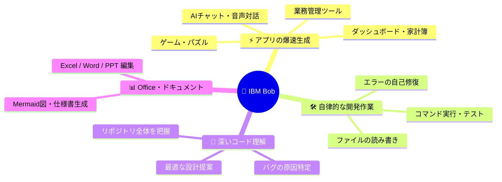
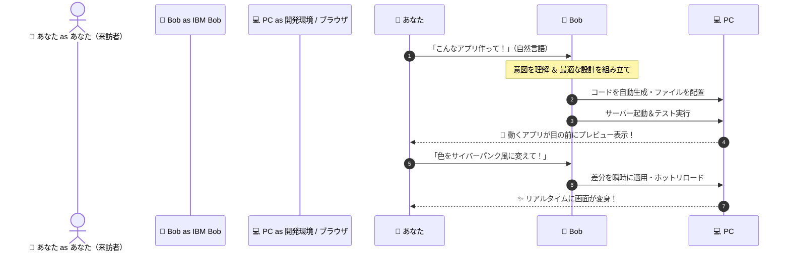

# 🚀 IBM Bobでできること！ — 展示会デモガイド

> **ようこそ IBM Bob のブースへ！**  
> IBM Bob は、**「あなたの言葉（自然言語）を理解し、実際に動くソフトウェアや成果物をゼロから自律的に創り出す」** 最先端のAIエンジニア・パートナーです。

---

## 🌟 30秒でわかる！Bobのココがすごい



---

## 🎯 Bobができること 5大パワー！

| パワー | アイコン | できることの例 | 驚きのポイント |
| :--- | :---: | :--- | :--- |
| **1. ゼロからアプリ爆速作成** | ⚡ | 「家計簿アプリ作って」「囲碁ゲーム作って」 | 数十秒で**実際にクリックして遊べるアプリ**が完成！ |
| **2. 会話しながらアプリを進化** | 🎨 | 「ダークモードにして」「木目調にして」「円グラフ追加して」 | あなたの好みに合わせて**リアルタイムに見た目・機能を追加**！ |
| **3. 自律的なエラー修正・テスト** | 🛠️ | プログラムの実行、テスト検証、エラー時の自動修正 | 失敗してもBobが自分で原因を見つけて**直して動かす**！ |
| **4. プロジェクト全体の丸ごと理解** | 🧠 | 「このコードのバグどこ？」「全体の構成を図にして」 | 膨大なファイル群を一瞬でスキャンして**的確に回答**！ |
| **5. Office & ドキュメント生成** | 📄 | Word / Excel / PowerPoint 編集、図解・仕様書作成 | コードだけでなく**ビジネス資料やグラフ**も自由自在！ |

---

## 🕹️ ブースで体験！「魔法のひと言」おためしプロンプト集

ブースのキーボードから、Bobにこう話しかけてみてください！ 👇

### 🎮 ① ゲームを作ってもらう
```text
「9路盤で遊べる囲碁ゲームを作って！石が置けて、相手と交互に打てるようにして」
```
👉 **追加のワガママ:** `「盤面を木目調にして！」「取った石の数をカウントして！」`

---

### 📊 ② 見やすいダッシュボードを作ってもらう
```text
「今月の支出がパッとわかる、オシャレな家計簿アプリを作って！グラフつきで！」
```
👉 **追加のワガママ:** `「円グラフを棒グラフに切り替えられるようにして！」「予算オーバーで警告を出して！」`

---

### 🤖 ③ AI対話アプリを作ってもらう
```text
「ツンデレなAIアシスタントと会話できるチャットアプリを作って！」
```
👉 **追加のワガママ:** `「メッセージに可愛い吹き出しをつけて！」「会話履歴を保存して！」`

---

### 📋 ③ タスク・業務管理アプリを作ってもらう
```text
「カンバン方式（ドラッグ＆ドロップ）でタスクを動かせるTODOアプリを作って！」
```
👉 **追加のワガママ:** `「完了したタスクに紙吹雪のエフェクトを出して！🎉」`

---

## 🔄 Bobが動く仕組み（体験のステップ）

Bobはただコードを表示するだけでなく、**「考えて、作って、動かして、確認する」** までを自律して行います。



---

## 💡 Bobの「3つの頭脳（モード）」

Bobは状況に応じてモードを切り替え、最適なサポートを提供します。

```text
┌─────────────────────────────────────────────────────────────┐
│ 🚀 1. Agent モード (開発者モード)                           │
│    コード作成、ファイル編集、コマンド実行を全自動で行う主力モード │
├─────────────────────────────────────────────────────────────┤
│ 📋 2. Plan モード (設計士モード)                            │
│    大規模な開発の前に、仕様書・手順・アーキテクチャをじっくり設計 │
├─────────────────────────────────────────────────────────────┤
│ 💡 3. Ask モード (先生・相談役モード)                       │
│    コードを変更せず、仕組みの質問や技術的な疑問にわかりやすく回答   │
└─────────────────────────────────────────────────────────────┘
```

---

## 🆚 従来のAIチャットと何が違うの？

| 比較ポイント | 一般的なAIチャット | 🤖 IBM Bob |
| :--- | :--- | :--- |
| **出力されるもの** | コードの断片テキスト（コピペが必要） | **プロジェクト全体のファイル・即実行可能なアプリ** |
| **実行と確認** | ユーザー自身が設定・実行・デバッグ | **Bobが自律実行・プレビューまで完結** |
| **修正・改善** | 「コードを直して」と頼んでまたコピペ | **会話するだけでリアルタイムに変更が反映** |
| **ファイルの扱い** | 1ファイルごとのやりとりが中心 | **プロジェクト全体（数千ファイル）を俯瞰して理解** |
| **作業範囲** | コーディングのみ | **コード＋コマンド実行＋Office資料作成** |

---

## 🎪 来訪者の皆さまへ

> **「こんなアイデア、作れるかな？」** と思ったら、何でもBobにぶつけてみてください！  
> プログラミングの知識がなくても大丈夫。あなたの言葉が、その場でカタチになります。
>
> ぜひブースのスタッフと一緒に、Bobのリアルタイムな開発体験をお楽しみください！✨
